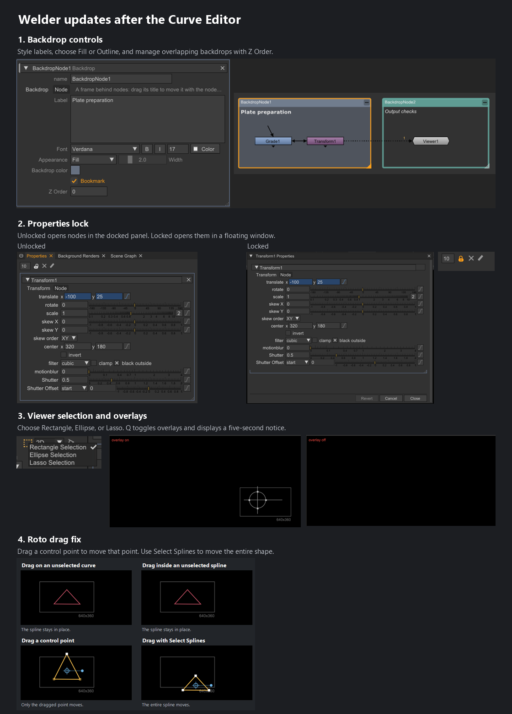

# Welder backdrop, Properties, Viewer, and Roto updates

1. **Backdrop controls.** Use multiline labels, font styling, and a **Color** button for label text. Choose **Fill** or **Outline** and adjust the outline width. **Bookmark** adds the backdrop to the Node Graph's Bookmarks menu, and **Z Order** controls which overlapping backdrop appears in front.
2. **Properties lock.** Double-clicking a node opens its controls in the docked Properties panel when unlocked or in a floating window when locked. The padlock changes shape and turns orange when locked. The floating window has **Revert**, **Cancel**, and **Close** controls.
3. **Viewer selection and overlays.** Choose **Rectangle**, **Ellipse**, or **Lasso** from the Viewer toolbar to select Roto points. Press **Q** over the Viewer to toggle 2D gizmos and format guides independently of the chosen tool. The upper-left notice disappears after five seconds.
4. **Roto dragging.** In the default Select tool, dragging an unselected spline outline or its interior leaves the shape in place. Drag a control point to move that point, or use **Select Splines** to move the entire shape.

