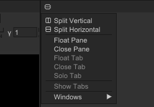
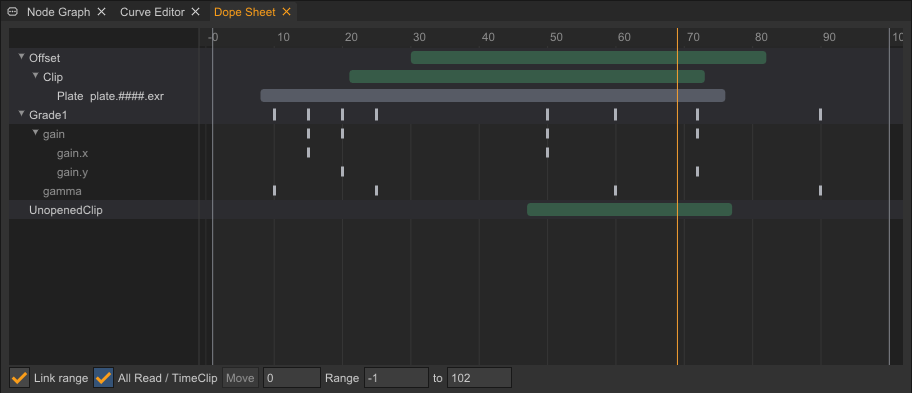
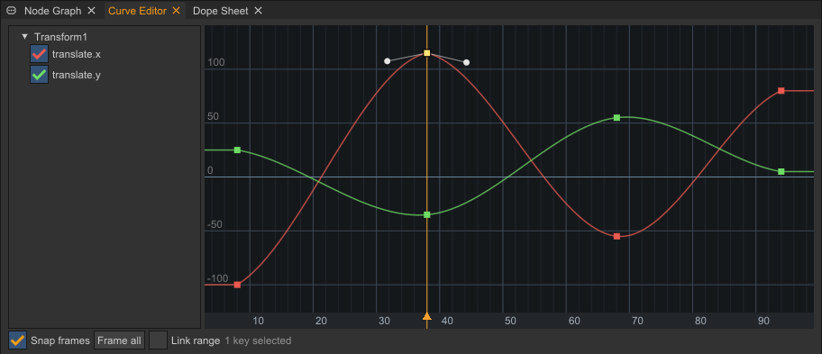
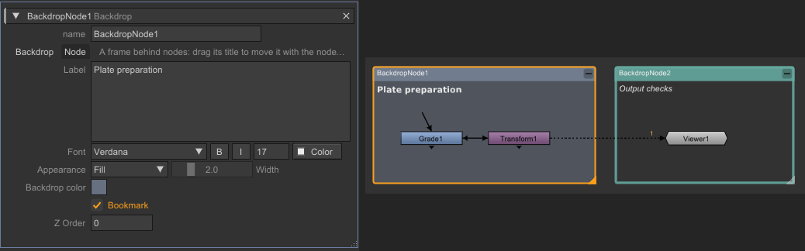

# Workspace and animation updates

These changes make it easier to arrange Welder's workspace, edit animation timing, and label groups of nodes. The Windows launcher remains `Welder.bat`.

## Pane layout and tabs

- Open the pane menu with the icon immediately left of the tabs. Use **Split Vertical** for side-by-side panes and **Split Horizontal** for stacked panes. Both commands remain available after a split, including from an empty pane.
- A new split shows just the pane menu icon. Open **Windows** from that icon to place a panel in the new pane, or choose **Close Pane** to remove it.
- Dockable panels have an individual **×** close button, including inactive tabs. Reopen a workspace panel from **Workspace**, or reopen a Viewer by name from **Viewer**. Closing a Viewer tab preserves its node and connections.
- Use the pane menu to float a pane or tab, solo the selected panel, or hide the tabs. Press **Space** or choose **Workspace → Restore Panels** to exit Solo. Click the corner marker to restore a hidden tab bar.

## Dope Sheet

- Expand nodes, animated controls, and vector channels in the hierarchy. Click a node name to open its Properties.
- Gray bars show Read ranges and green bars show time-node ranges. Narrow vertical ticks mark keyframes. Selected keys and the playhead are orange, and gray vertical lines mark the project's first and last frames.
- Turn on **All Read / TimeClip** to include clips with closed Properties panels. Set the viewport with **Range**, or turn on **Link range** to share it with the Curve Editor.
- Select keys and use **Move** with a positive or negative frame offset. Welder limits the move before the selection would pass a neighboring key on the same curve. The field retains the last entered offset for reuse.

## Curve Editor

The curve graph has a collapsible channel list, a bottom frame ruler, and footer controls for **Snap frames**, **Frame all**, and **Link range**. Click or drag on the ruler to scrub. Drag a key to change its time and value, or use its tangent handles to shape the interpolation. In the Transform example, red shows X translation and green shows Y translation. The selected X key displays both handles.

## Backdrop

Backdrop Properties include a multiline label, font family, bold and italic styles, font size, and a **Color** button with an inset label-color swatch. Choose **Fill** or **Outline**, set the backdrop color, and adjust **Width** for outlines. **Bookmark** adds the backdrop to the Node Graph's Bookmarks menu. Higher **Z Order** values place a backdrop in front of overlapping backdrops.

