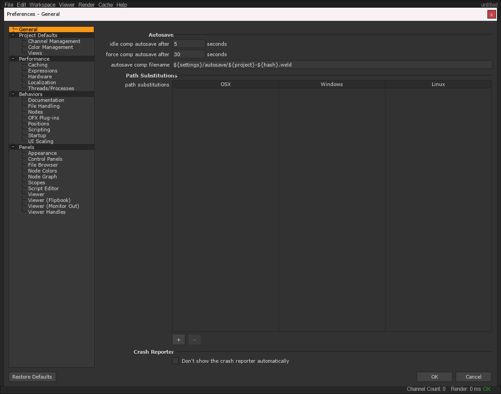
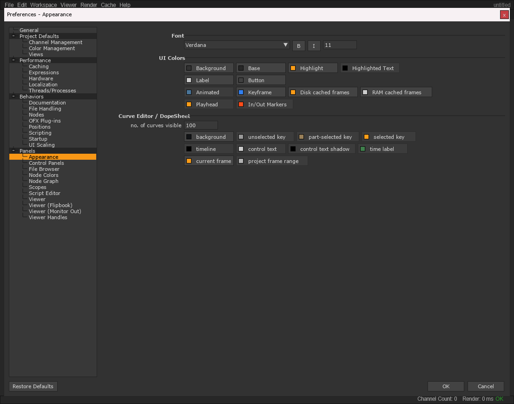
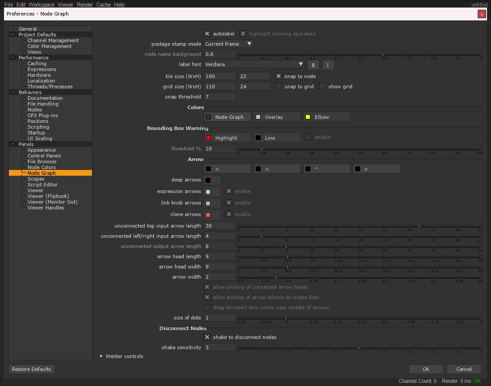
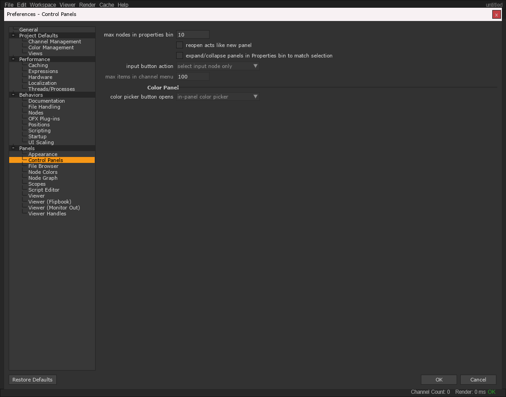

# Preferences screenshot gallery

These are current captures from the running Welder editor, using isolated default settings. The screenshots include the DirectWrite text update. Open an image at full resolution to judge text clarity. Disabled controls identify capabilities not implemented by this build. See [Preferences behavior and availability](preferences.md) for details.

| Page | Full-size screenshot |
| --- | --- |
| General | [General](screenshots/preferences/general.png) |
| Channel Management | [Channel Management](screenshots/preferences/channel-management.png) |
| Color Management | [Color Management](screenshots/preferences/color-management.png) |
| Views | [Views](screenshots/preferences/views.png) |
| Caching | [Caching](screenshots/preferences/caching.png) |
| Expressions | [Expressions](screenshots/preferences/expressions.png) |
| Hardware | [Hardware](screenshots/preferences/hardware.png) |
| Localization | [Localization](screenshots/preferences/localization.png) |
| Threads/Processes | [Threads/Processes](screenshots/preferences/threads-processes.png) |
| Documentation | [Documentation](screenshots/preferences/documentation.png) |
| File Handling | [File Handling](screenshots/preferences/file-handling.png) |
| Nodes | [Nodes](screenshots/preferences/nodes.png) |
| OFX Plug-ins | [OFX Plug-ins](screenshots/preferences/ofx-plug-ins.png) |
| Positions | [Positions](screenshots/preferences/positions.png) |
| Scripting | [Scripting](screenshots/preferences/scripting.png) |
| Startup | [Startup](screenshots/preferences/startup.png) |
| UI Scaling | [UI Scaling](screenshots/preferences/ui-scaling.png) |
| Appearance | [Appearance](screenshots/preferences/appearance.png) |
| Control Panels | [Control Panels](screenshots/preferences/control-panels.png) |
| File Browser | [File Browser](screenshots/preferences/file-browser.png) |
| Node Colors | [Node Colors](screenshots/preferences/node-colors.png) |
| Node Graph | [Node Graph](screenshots/preferences/node-graph.png) |
| Scopes | [Scopes](screenshots/preferences/scopes.png) |
| Script Editor | [Script Editor](screenshots/preferences/script-editor.png) |
| Viewer | [Viewer](screenshots/preferences/viewer.png) |
| Viewer (Flipbook) | [Viewer (Flipbook)](screenshots/preferences/viewer-flipbook.png) |
| Viewer (Monitor Out) | [Viewer (Monitor Out)](screenshots/preferences/viewer-monitor-out.png) |
| Viewer Handles | [Viewer Handles](screenshots/preferences/viewer-handles.png) |

## General

## Appearance

## Node Graph

## Control Panels

