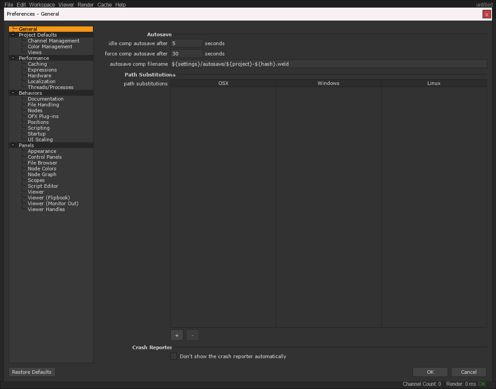
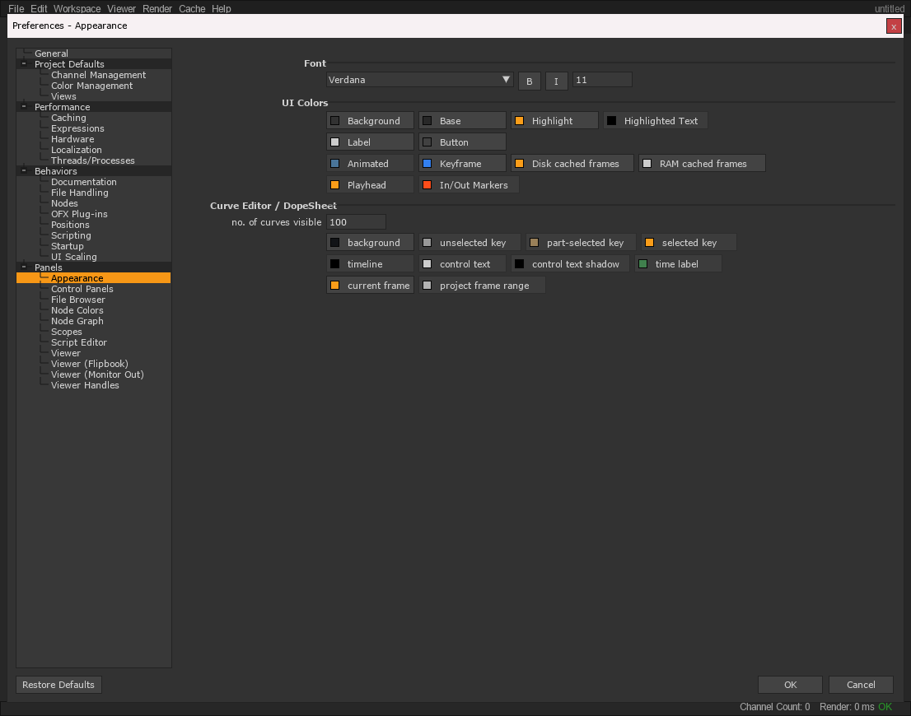
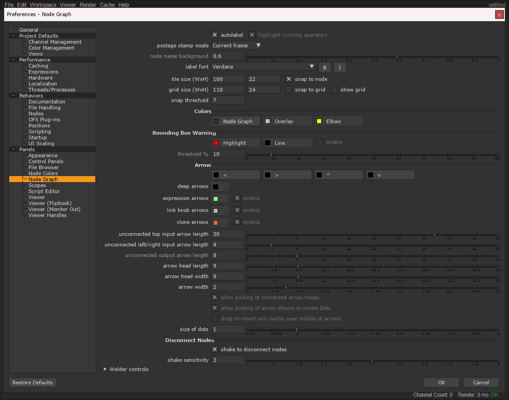

# Preferences

Open **Edit > Preferences** or press **Shift+S**. Welder 0.2.6 / PFX Build 001 retains its existing application and launcher names.

The dialog follows the supplied reference layout: a compact category tree, square value fields, ruler sliders, X checkboxes, inset color swatches, section rules, a light title bar, and fixed bottom actions. The 28 distinct pages cover General, project defaults, performance, behaviors, and panels. Smaller windows scroll the content within the dialog.

## Saving and cancelling

- **OK** validates and saves the draft, then applies supported changes.
- **Cancel**, Escape, and the close button discard the draft.
- **Restore Defaults** resets the draft; it only changes saved settings after OK.
- Font and color changes apply in the editor; UI scaling and startup settings apply on the next launch.
- Existing settings such as cache location, Python, MCP, update checks, network paths, and graph interaction remain available. Opening Preferences does not change them.

## Connected controls

General controls include idle/forced autosave intervals, an autosave filename template, cross-platform path substitutions, the channel warning threshold, and crash-report display. Templates support `${settings}`, `${cache}`, `${project}` and `${hash}`. The default hash separates projects with the same name, and autosave refuses to overwrite the open project itself. Path substitution uses the longest matching directory prefix and does not alter saved source paths.

Project defaults configure the working, integer-input and viewer color transforms for new compositions. Existing compositions retain their own settings. Hardware shows the detected compute device and controls GPU rendering. Cache budgets, background cache policy, undo depth, frame-server process limits, and render thread limits connect to their existing implementations.

Node controls include Merge's automatic A/B connection choice and Viewer open/close behavior. Startup controls select a saved workspace, the splash screen, and update checks. UI scaling follows the display automatically or uses a manual scale. Appearance includes installed fonts, font styles, interface colors and supported animation/cache colors.

Control Panels manages the panel limit, reopening order, and expansion to match selection. File Browser supports its recent-directory preference and the sequence filename style. Node Colors edits category/type matching and color swatches; explicit node-type matches take priority over category matches. Node Graph supports tile dimensions, grid display/snapping, node snapping, arrow dimensions/colors, dot size, label font, shading, and shaking to disconnect.

Script Editor connects its font, history, echo, and clear-after-success options. Viewer controls include floating new viewers and preserving zoom. Viewer Handles connects the 2D transform color/size and 3D camera interaction speed.

## Availability

This is a Welder preferences implementation, not a Nuke runtime. Unsupported controls remain visible in their reference pages but disabled, with an explanation on hover. These include stereo/multiview setup, media localization, Monitor Out/NDI/HMD, Tcl, analytics submission, separate per-node cache budgets, GPU device/cache-budget selection, image scopes, and several specialized handle/display options. They do not silently pretend to change renderer behavior. OpenColorIO controls depend on whether the application was built with OpenColorIO; this local build uses the built-in color transforms.

## Verification

- Full engine regression: **45,333 checks, zero failures**.
- Preferences validation/persistence/path-mapping tests: **22 passed**.
- All 28 distinct Preferences pages rendered without errors.
- Real editor interaction verified OK persists a panel limit of 17 and Cancel retains 17 after editing it to 23.
- Restore Defaults + Cancel preserves the saved value; Restore Defaults + OK saves the default.
- Cancelling a folder chooser retains a draft cache-budget edit (31 GB), which saves correctly afterward.
- Narrow-window layout checked at 700 x 550.
- Installed editor smoke test passed opening, rendering, playback, editing, painting, autosave and recovery.

[Complete gallery: all 28 Preferences pages](preferences-gallery.md)
