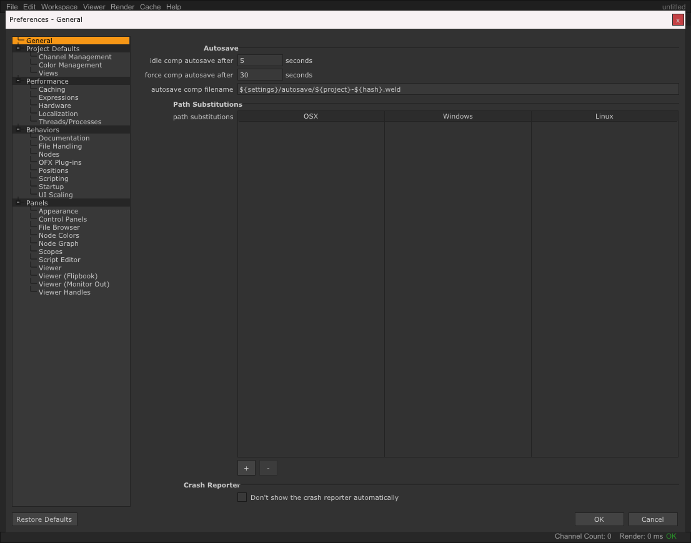
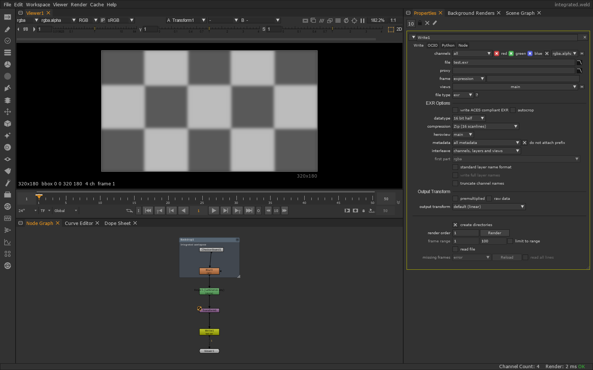

# Text clarity

Welder uses native DirectWrite grayscale text rasterization on supported Windows systems. Glyph outlines are grid-fitted at their actual framebuffer density, preserving crisp stems without ClearType color fringes. The existing stb font renderer remains available automatically when native rendering or a font is unsupported.

Font sizes in Preferences are interpreted as typographic points, rather than squeezing an 11-point choice into 11 pixels. The default 11-point interface renders at approximately 15 pixels on a 100% display; the Script Editor uses the same conversion. Font advances snap to pixels, and unnecessary vertical oversampling has been removed. Fonts continue to be baked at the size requested by each interface element.

The renderer applies to menus, properties, Preferences, node labels, timeline text, installed label fonts and Script Editor text. It does not sharpen or alter compositing pixels in the Viewer.

Validation: 3,529 glyph/metric checks pass with DirectWrite and another 3,529 with the fallback renderer, across five common font faces, four text sizes and four framebuffer densities (100%, 125%, 150%, 200%). The checks include descenders, negative bearings, numbers, spaces and accented glyphs, as well as font-atlas destruction. Existing installed-font and preferences tests also pass.

Implementation reference: [Microsoft DirectWrite glyph-run analysis](https://learn.microsoft.com/en-us/windows/win32/api/dwrite_2/nf-dwrite_2-idwritefactory2-createglyphrunanalysis).

## Actual editor screenshots

Open these images at full resolution; browser thumbnail scaling can soften text.

### Before

### After

### Workspace and node controls

