# Write controls and timeline update

This update adds extension-specific Write controls and refines the compact timeline. The images below are captures of the running Welder editor, not mockups. The layout follows the supplied Nuke references; this is not a claim of complete Nuke feature or pixel-for-pixel compatibility.

## What changes when a filename is edited

Typing a filename selects its format panel, including uppercase extensions such as `.MP4` and `.PNG`. Choosing a file type updates the filename extension. MOV and MP4 share the movie controls. Switching formats hides unrelated controls without erasing their saved settings.

The common rows remain channels, file, proxy, frame mapping, views and file type. Format options appear above Output Transform, followed by directory creation, render order, Render, frame limits and readback controls. Existing channel and metadata defaults are retained for compatibility with saved Welder compositions.

| Format | Controls connected to the writer |
| --- | --- |
| EXR | Half/float storage, compression and DWA level, autocrop, ACES output, metadata policy/prefix, interleave, first part and channel naming |
| MOV / MP4 | Codec/profile, FPS, quality, YCbCr matrix, audio file and offset, fast start and upstream timecode |
| PNG | 8-bit or 16-bit data |
| JPEG | Quality and sub-sampling |
| DPX | Bit depth, packing, byte order and transfer characteristic |

## EXR

EXR options include single-part and multipart output, layer ordering, full/standard/truncated channel names and metadata handling. ACES output converts RGB to AP0, writes ACES chromaticities/container metadata, and constrains storage to half-float, uncompressed, single-part RGB(A).

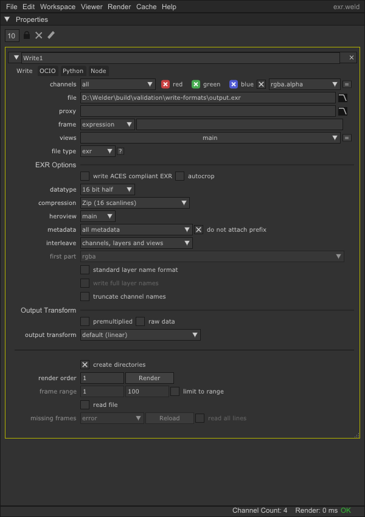

Compression choices use descriptive names. Dropdown checkboxes and names occupy separate columns, with their vertical positions derived from each selectable row. This fixes names overlapping the checkbox area.

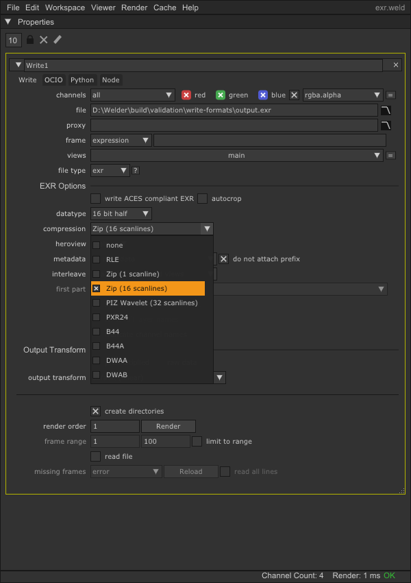

## Channel and layer menus

Write's first channel menu now lists `all`, `none`, `rgb`, `rgba` and `alpha`, followed by **other layers** and **new**. The submenu includes the standard depth, motion, forward/backward, disparity, mask, sample, cutout and deep entries, together with layers found on the connected input.

The extra-channel menu lists `none`, the four `rgba` components, **other channels** and **new**. The submenu contains the corresponding individual channel names and actual input channels. Both menus use aligned checkbox/text columns, consistent row spacing and orange selection.

| Layer submenu | Extra-channel submenu |
| --- | --- |
| 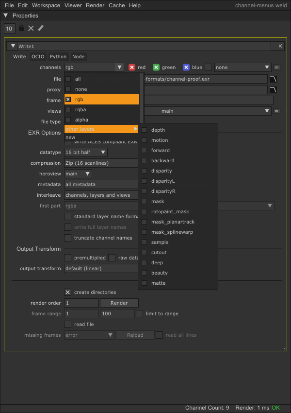 | 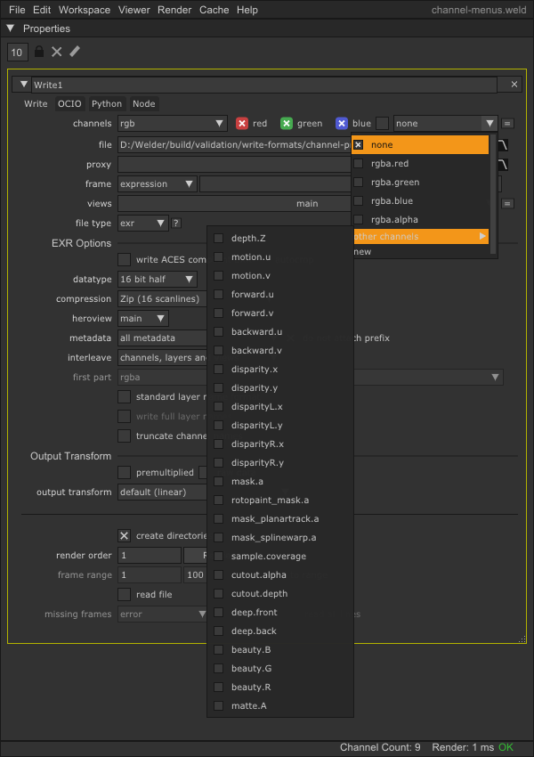 |

The **new** actions open editable dialogs for a layer/component list or a full `layer.channel` name. Definitions and the extra-channel selection are saved with the Write node. Selecting a layer stores its explicit channels; selecting an extra channel preserves the selected RGB channels. Registered names do not create source image data: missing channels are written as zero. EXR supports the arbitrary channels shown here; RGB-only formats retain their existing channel restrictions.

## Movies

Movie controls group related codecs into families and expose their corresponding profiles. FPS is independent of the project frame rate. Audio offset accepts seconds or frames. Advanced controls include fast start, timecode and applicable data-range/encoder settings.

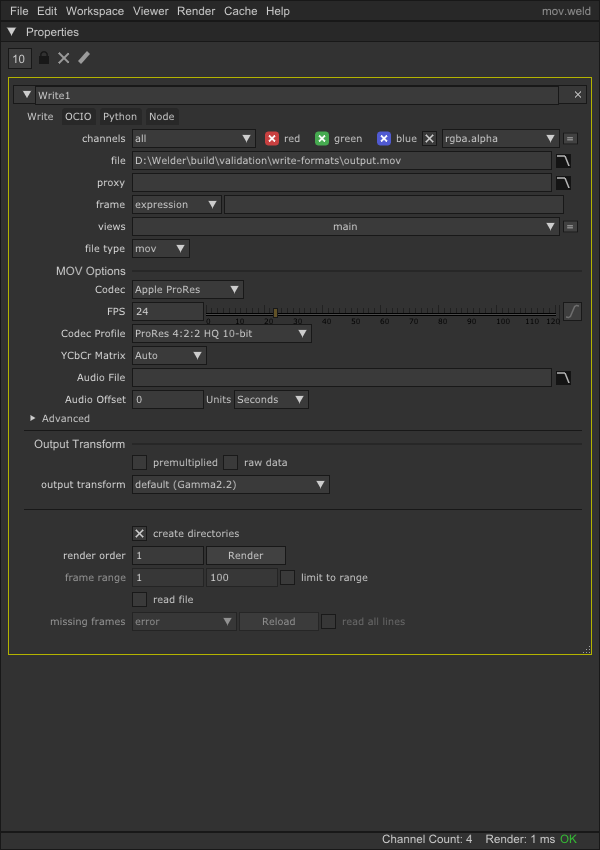

The codec menu uses aligned checkbox and text columns, a consistent row pitch and orange selection. Encoders absent from the build are disabled.

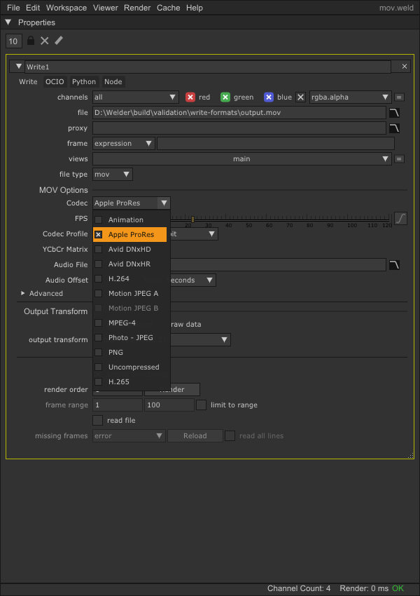

H.264 and H.265 expose profile/quality controls and use the existing hardware encoder selection. Availability at render time also depends on the installed GPU and driver.

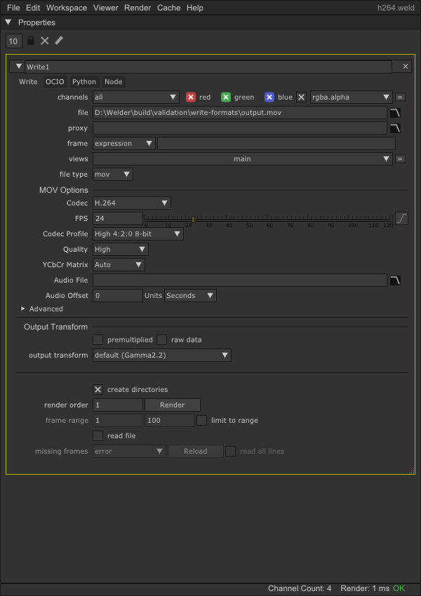

Audio is copied from the selected file into a compatible output container; this change does not implement audio transcoding. Incompatible combinations produce an error. Timecode is taken from upstream metadata, for example an AddTimeCode node.

Movie output and selectable JPEG sub-sampling require an FFmpeg-enabled build. Without FFmpeg, still-image output uses the existing fallback writer.

## PNG, JPEG and DPX

PNG offers 8-bit/16-bit output. JPEG offers a quality rail and sub-sampling menu. DPX offers bit depth, packed/filled storage, big/little endian and a transfer field.

| PNG | JPEG | DPX |
| --- | --- | --- |
| 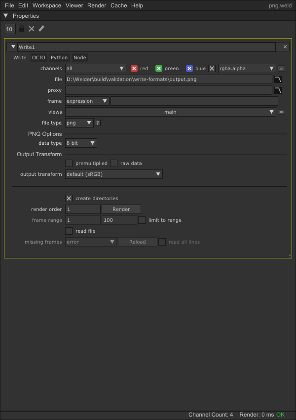 | 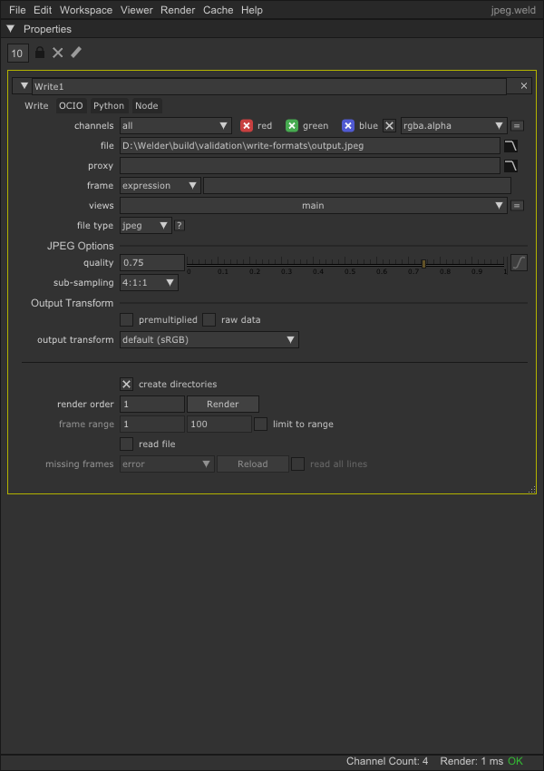 | 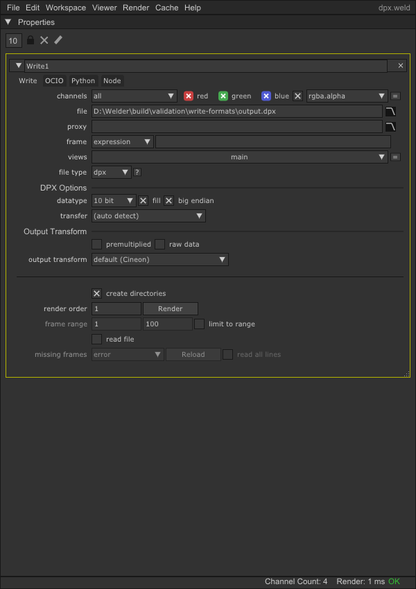 |

## Output transform and additional tabs

Default output labels reflect the selected format: linear for EXR, sRGB for PNG/JPEG, Gamma2.2 for movies and Cineon for DPX. Built-in conversions now include gamma curves, Rec.709, Cineon and ACES AP0. Movie readers use transfer tags and fall back to container color-matrix tags when a decoded frame omits them, fixing ProRes color round trips.

The OCIO tab provides four context key/value pairs. These are applied when Welder is compiled with OpenColorIO and the active configuration uses them. The tested local Windows build uses built-in transforms; additional log/HDR choices that it cannot resolve are disabled.

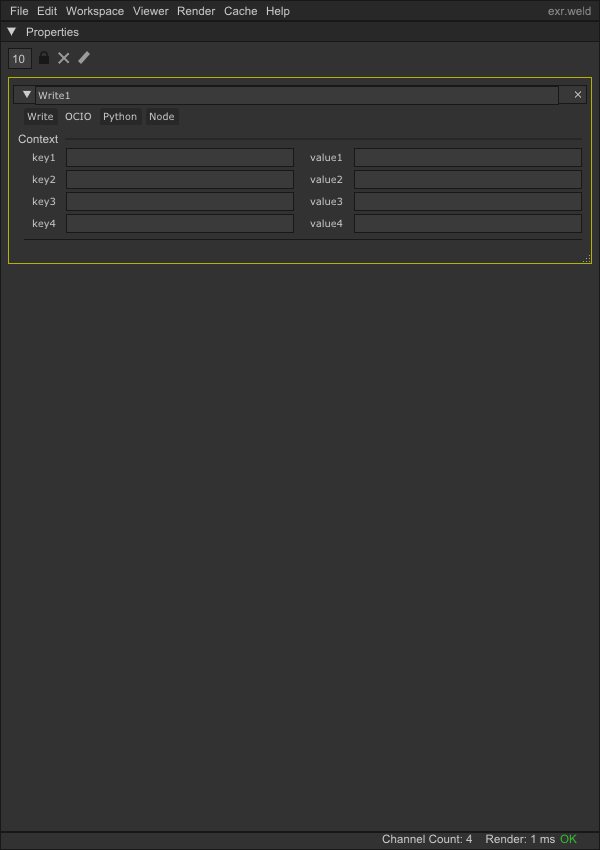

The Python tab exposes Before Render, Before Each Frame, After Each Frame, After Render and Render Progress callbacks. Callbacks execute with the configured Python interpreter and receive `event`, `node_name`, `frame`, `first_frame`, `last_frame`, `progress` and `output_path`. These are Welder callback globals, not a Nuke Python API implementation. Callback failures propagate to the render.

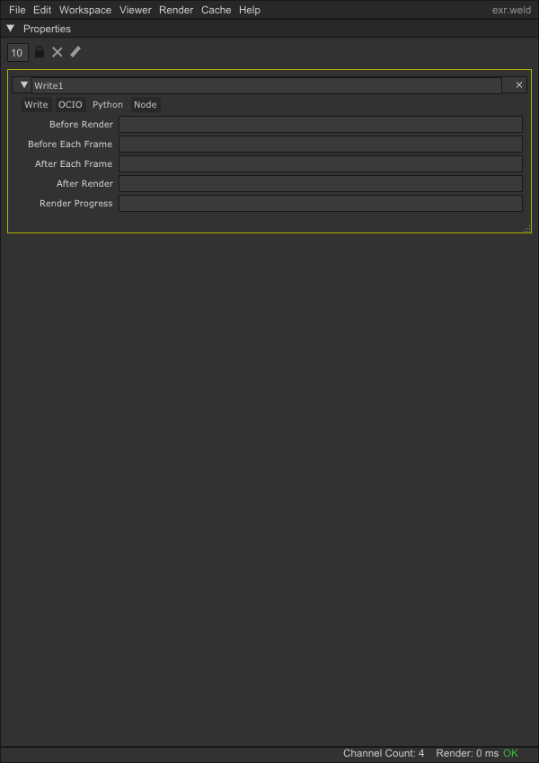

The Node tab includes the larger label editor and the shared font, color, visibility, cache, disable, bookmark, postage stamp and lifetime controls.

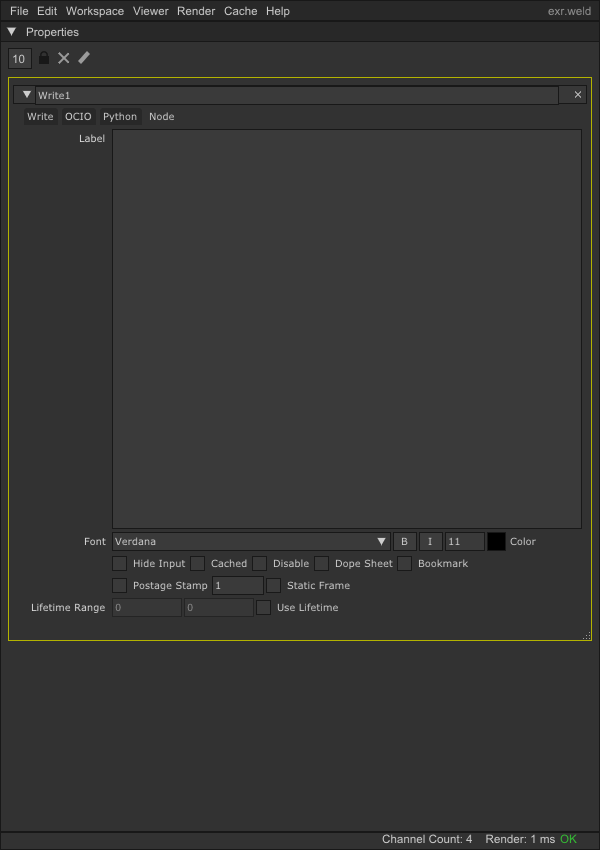

## Alignment and resizing

The Write panel uses compact fields, right-aligned labels, consistent row spacing and a yellow border. At narrow widths, inline options wrap and RGB checkbox names collapse to compact marks with hover labels so the alpha selector remains inside the panel.

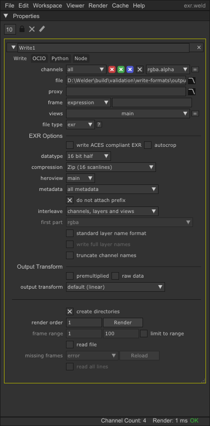

## Timeline

The timeline now uses a compact fixed-height strip with revised ruler spacing, centered frame fields, beveled transport buttons, filled playback symbols, triangle-and-key navigation icons, range locking, cache controls and a compact options chevron. Secondary actions remain available through the options menu when space is limited. Maximizing the Viewer preserves the timeline strip height.

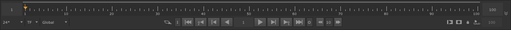

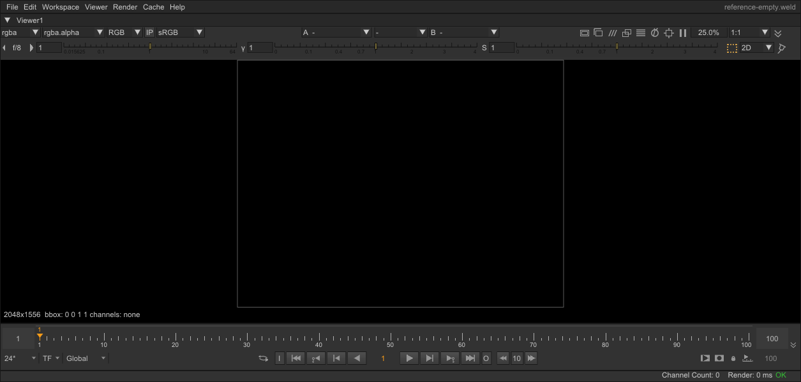

## Rendering and interchange details

- Frame mapping supports expressions, offset (`frame + value`) and start-at (`frame - first + value`).
- Proxy paths, directory creation, frame limits and readback/missing-frame controls are connected to rendering.
- The editor's batch renderer orders Write nodes by render order.
- `.nk` interchange carries the added EXR naming/interleave flags, JPEG controls, DPX packing/byte order, context fields and callback strings. Movie codec interchange retains its existing warning and still needs verification in Nuke.
- Windows builds accept shared FFmpeg development packages, copy runtime DLLs into the build folder, and include them when packaging. The local package uses the LGPL shared build documented in `THIRD_PARTY_NOTICES.md`; generated executables and DLLs are not stored in Git.

## Validation

| Check | Result |
| --- | --- |
| Write engine group, including Python callbacks | 138 checks passed |
| File formats and movie codecs | 160 checks passed |
| Read engine group | 33 checks passed |
| EXR/deep EXR round trips | 24 checks passed |
| Python `.nk` importer suite | 67 tests completed successfully; 1 skipped |
| Installed editor smoke test | PASS |
| Installed executable hash comparison | Matches the tested build |
| Source whitespace check | `git diff --check` passed |

The format tests inspect actual output: DPX packing/byte order, JPEG sampling ratios, PNG depth, multipart EXR structure and ACES metadata/pixels. Movie tests exercised ProRes, DNxHR, MJPEG, MPEG-4, FFV1, PNG and H.264/H.265; H.264/H.265 succeeded through NVENC on the test machine. An additional rendered MOV was inspected for ProRes HQ, 30 FPS, a two-frame audio offset, embedded timecode and fast-start atom ordering.

Visual checks covered all six main format layouts, the OCIO/Python/Node tabs, codec/compression dropdowns and a 420-pixel-wide panel. A scripted editor interaction verified that typing `.MP4` switches the panel automatically. The final alignment change was rebuilt and visually checked in both codec and EXR compression menus.

Additional scripted channel-menu checks selected a depth layer, created a new RGBA layer, and entered/saved `matte.A` as an extra channel. Rendered EXR headers and pixels confirmed `depth.Z = 0.2`, zero values for the newly declared channels, and `matte.A = 0.75` alongside the original RGB values. The illustrated guide includes 16 screenshots after this channel-menu update.

To repeat the engine checks, build `welder_ui`, `welder` and `welder_tests`, then run the test executable with `STRATA_TEST` set to `Write`, `File formats:`, `Read:` or `EXR round trip`. Set `STRATA_TEST_PYTHON` to a Python executable to include callback execution. Run the importer suite with `python -m unittest tests/test_nk2strata.py`.
